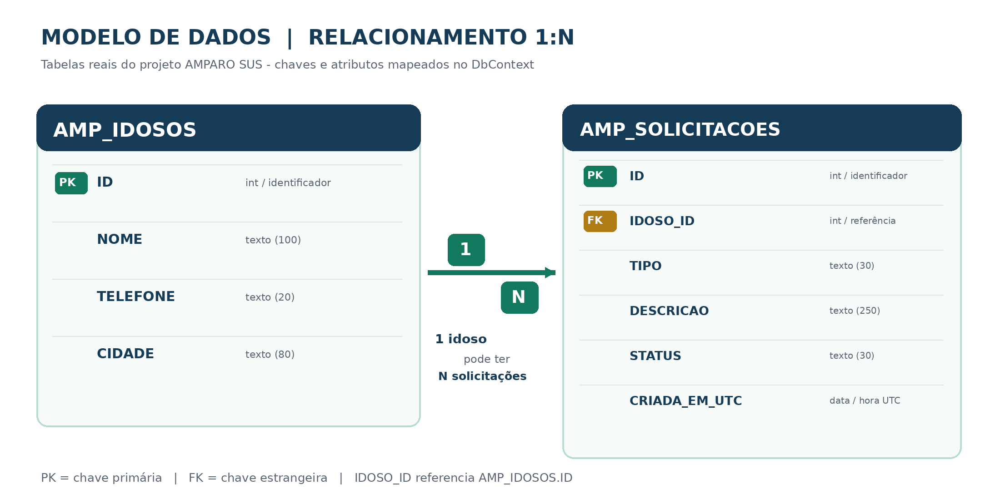
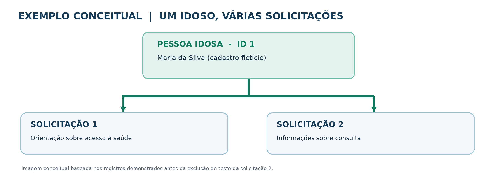

# AMPARO SUS — API REST em C# / .NET 8 com Oracle

**Global Solution 2026/2 · FIAP · CitizenTech**

## 1. Nosso projeto

Desenvolvemos o **AMPARO SUS**, um protótipo acadêmico voltado ao registro e acompanhamento de solicitações de apoio feitas por pessoas idosas. Usamos dados fictícios para demonstrar como uma pessoa pode ser cadastrada e ter várias solicitações de orientação associadas ao mesmo cadastro.

Por exemplo: Maria da Silva pede orientação para compreender como acessar informações sobre um serviço de saúde. A API registra a solicitação e permite acompanhar seu status. Nosso protótipo **não se conecta a sistemas oficiais do SUS**: ele demonstra a organização e o armazenamento desses pedidos em um banco de dados Oracle.

Usamos uma **API REST**, ou seja, um programa que recebe pedidos por endereços HTTP e responde com dados em JSON. Assim, outras aplicações podem consultar ou enviar informações de forma organizada.

## 2. Integrantes

| Integrante | RM | Turma |
|---|---|---|
| Denise Santos | 567559 | 2TDSPA |
| Karen Cardoso | 566870 | 2TDSPA |
| Lucas Dudena | 567600 | 2TDSPA |
| Pedro Begali | 567478 | 2TDSPA |

## 3. Tecnologias e ferramentas

| Tecnologia | Como usamos no projeto |
|---|---|
| C# e ASP.NET Core 8 | Desenvolvemos a API e as rotas HTTP. |
| Web API com Controllers | Organizamos as operações de cadastro e consulta. |
| Entity Framework Core 8 | Ligamos classes C# ao banco Oracle e executamos consultas. |
| Oracle.EntityFrameworkCore | Utilizamos o provedor de acesso ao Oracle pelo EF Core. |
| Oracle Database FIAP | Armazenamos os cadastros e as solicitações em duas tabelas relacionadas. |
| Migrations | Criamos e versionamos as instruções de estrutura do banco. |
| Visual Studio | Abrimos, compilamos, executamos e testamos o projeto. |
| Oracle SQL Developer | Conferimos as tabelas e os dados gravados pela API. |
| Arquivo `.http` | Enviamos GET, POST, PUT e DELETE sem precisar criar uma interface visual. |

## 4. Entendendo a estrutura do projeto

O arquivo de solução **`AMPARO_SUS_NET.sln`** abre o projeto no Visual Studio. Dentro do projeto **`AmparoSus.Api`**, os principais arquivos são:

```text
AMPARO_SUS_NET/
├── AMPARO_SUS_NET.sln
├── README.md
├── .gitignore
├── AmparoSus.Api/
│   ├── AmparoSus.Api.csproj        <- dependências e .NET 8
│   ├── Program.cs                 <- inicialização e conexão Oracle
│   ├── Controllers/
│   │   ├── IdososController.cs    <- rotas dos idosos
│   │   └── SolicitacoesController.cs <- rotas das solicitações
│   ├── Data/
│   │   └── AmparoSusDbContext.cs <- mapeamento das tabelas
│   ├── Models/                    <- classes Idoso e SolicitacaoApoio
│   ├── DTOs/                      <- dados recebidos e devolvidos
│   ├── Migrations/                <- histórico de criação do banco
│   ├── Properties/launchSettings.json
│   └── AmparoSus.Api.http         <- requisições de teste
└── docs/
    ├── AMPARO_SUS_Relatorio_Evidencias_NET_GS2026.pdf
    ├── GUIA_EXECUCAO_PASSO_A_PASSO.md
    ├── AMPARO_SUS_Consultas_Oracle.sql
    ├── diagrama_entidades_1N.png
    ├── exemplo_relacionamento_maria.png
    ├── fluxo_api_oracle.png
    └── EVIDENCIAS/
```

**Models** são os objetos do nosso projeto. **Controllers** são as partes que recebem uma chamada HTTP. **DTOs** são os formatos dos dados de entrada e saída. **DbContext** conecta essas classes ao Oracle.

## 5. Nosso modelo de dados



Criamos duas tabelas: `AMP_IDOSOS` e `AMP_SOLICITACOES`.

- `AMP_IDOSOS`: guarda **ID, NOME, TELEFONE e CIDADE**.
- `AMP_SOLICITACOES`: guarda **ID, IDOSO_ID, TIPO, DESCRICAO, STATUS e CRIADA_EM_UTC**.
- **PK** (chave primária): identifica cada registro pelo seu ID.
- **FK** (chave estrangeira): `AMP_SOLICITACOES.IDOSO_ID` aponta para `AMP_IDOSOS.ID`.

O relacionamento é **1:N**: um idoso pode ter várias solicitações e cada solicitação pertence a um idoso. Isso foi demonstrado com duas solicitações fictícias para Maria da Silva.



## 6. Como abrir e compilar no Visual Studio

Usamos o **Visual Studio para Windows** com suporte a desenvolvimento Web em C# e **SDK .NET 8**.

1. Abra o **Visual Studio**.
2. Clique em **Arquivo > Abrir > Projeto/Solução**.
3. Escolha `AMPARO_SUS_NET.sln`. Abra a **solução**, e não somente a pasta.
4. Aguarde a restauração dos pacotes NuGet. Na janela **Gerenciador de Soluções**, o projeto deve aparecer como `AmparoSus.Api`.
5. Clique em **Compilação > Compilar Solução** (atalho `Ctrl + Shift + B`).
6. Na parte inferior, abra **Exibir > Saída** e escolha **Compilação**. A mensagem de compilação bem-sucedida confirma que o código foi construído.

Os pacotes usados no projeto constam em `AmparoSus.Api.csproj`. Eles são restaurados pelo NuGet quando abrimos e compilamos a solução.

## 7. Configurando o Oracle da FIAP

Primeiro, abra o **Oracle SQL Developer** e confira sua conexão à FIAP. No ambiente de testes utilizamos:

- Servidor: `oracle.fiap.com.br`
- Porta: `1521`
- Identificação do banco: **SID `ORCL`**
- Usuário: o usuário Oracle fornecido individualmente pela FIAP

**A senha não deve ser escrita no `Program.cs`, no `appsettings.json` nem no GitHub.** Ela é configurada localmente no Visual Studio:

1. No **Gerenciador de Soluções**, clique com o botão direito em `AmparoSus.Api`.
2. Escolha **Gerenciar Segredos do Usuário**.
3. O Visual Studio abrirá um `secrets.json` armazenado no seu computador.
4. Coloque o exemplo abaixo, substituindo `SEU_USUARIO` e `SUA_SENHA` pelas credenciais do seu próprio acesso:

```json
{
  "ConnectionStrings": {
    "Oracle": "User Id=SEU_USUARIO;Password=SUA_SENHA;Data Source=(DESCRIPTION=(ADDRESS=(PROTOCOL=TCP)(HOST=oracle.fiap.com.br)(PORT=1521))(CONNECT_DATA=(SID=ORCL)));"
  }
}
```

5. Salve com `Ctrl + S` e mantenha esse arquivo **fora do repositório**.

No `Program.cs`, a linha `GetConnectionString("Oracle")` lê essa configuração. O Entity Framework usa a conexão para acessar as tabelas. A opção `OracleSQLCompatibility.DatabaseVersion19` mantém a geração das consultas SQL compatível com a versão do Oracle utilizada na demonstração.

## 8. Como as tabelas são criadas

Nós usamos **Migrations** do Entity Framework Core. Isso significa que as tabelas são definidas no código C# e criadas pelo framework, sem precisar digitar `CREATE TABLE` no SQL Developer.

Para aplicar as Migrations já versionadas no projeto:

1. No Visual Studio, clique em **Ferramentas > Gerenciador de Pacotes NuGet > Console do Gerenciador de Pacotes**.
2. Em **Projeto padrão**, selecione `AmparoSus.Api`.
3. Execute:

```powershell
Update-Database -Context AmparoSusDbContext
```

O comando lê as Migrations do projeto e aplica no banco as versões ainda não registradas. Em seguida, o Oracle passa a ter as tabelas `AMP_IDOSOS`, `AMP_SOLICITACOES` e o histórico `__EFMigrationsHistory`.

**Como geramos a Migration inicial:** durante a construção do projeto, criamos a primeira versão com:

```powershell
Add-Migration InicialAmparoSus -Context AmparoSusDbContext -OutputDir Migrations
```

Esse segundo comando serve para **criar uma nova Migration a partir das classes**. Quando usamos uma cópia do projeto que já contém a Migration inicial, aplicamos diretamente com `Update-Database`; não é necessário gerar a mesma Migration novamente.

### Conferindo no SQL Developer

Abra uma planilha SQL na mesma conta Oracle utilizada pela API e execute `docs/AMPARO_SUS_Consultas_Oracle.sql`. Para ver as respostas em tabela, usamos **Ctrl + Enter**. A tecla **F5** mostra o resultado em formato de script.

## 9. Como iniciar a API

1. No Visual Studio, clique com o botão direito em `AmparoSus.Api` e escolha **Definir como Projeto de Inicialização**, caso necessário.
2. Na barra superior, selecione o perfil **`http`**.
3. Clique no botão verde de executar (`F5`) e mantenha a aplicação aberta.
4. Acesse `http://localhost:5185/` no navegador.

A rota inicial retorna um JSON semelhante a:

```json
{
  "projeto": "AMPARO SUS",
  "descricao": "API acadêmica para cadastro de idosos e solicitações de apoio",
  "rotas": ["/api/idosos", "/api/solicitacoes"]
}
```

A URL usa `localhost` porque, nesse teste, a API está rodando no nosso computador. A porta **5185** está configurada em `Properties/launchSettings.json`.

## 10. Como executar os testes HTTP

Com a API executando, abra **`AmparoSus.Api/AmparoSus.Api.http`** no Visual Studio. Cada bloco contém um método HTTP e o endereço da API. Clique em **Enviar solicitação** acima do bloco desejado. O painel à direita mostra o **código de resposta HTTP** e os dados JSON, quando existirem.

| Método | Exemplo da rota | O que faz | Código de sucesso |
|---|---|---|---|
| GET | `/api/idosos` | Lista pessoas cadastradas. | 200 OK |
| GET | `/api/idosos/1` | Consulta uma pessoa pelo ID. | 200 OK |
| POST | `/api/idosos` | Cria um cadastro. | 201 Created |
| PUT | `/api/idosos/1` | Atualiza um cadastro. | 204 No Content |
| DELETE | `/api/idosos/2` | Exclui um cadastro de teste pelo ID. | 204 No Content |
| GET | `/api/solicitacoes` | Lista solicitações. | 200 OK |
| GET | `/api/solicitacoes/1` | Consulta uma solicitação. | 200 OK |
| POST | `/api/solicitacoes` | Cria solicitação ligada a um idoso. | 201 Created |
| PUT | `/api/solicitacoes/1` | Atualiza uma solicitação. | 204 No Content |
| DELETE | `/api/solicitacoes/2` | Exclui uma solicitação de teste. | 204 No Content |

**Exemplo de cadastro de idoso:**

```http
POST http://localhost:5185/api/idosos
Content-Type: application/json

{
  "nome": "Maria da Silva",
  "telefone": "11999998888",
  "cidade": "São Paulo"
}
```

O retorno **201 Created** vem acompanhado do novo `id`. Esse número é usado nas próximas consultas. Em outro banco, o ID pode ser diferente de 1.

**Exemplo de solicitação vinculada:**

```http
POST http://localhost:5185/api/solicitacoes
Content-Type: application/json

{
  "idosoId": 1,
  "tipo": "ORIENTACAO",
  "descricao": "Preciso de ajuda para entender como acessar um serviço de saúde.",
  "status": "PENDENTE"
}
```

Nesse exemplo, `idosoId: 1` significa que a solicitação pertence à pessoa cadastrada com ID 1. Ajuste o número para o ID retornado pelo seu POST anterior.

**Valores aceitos no cadastro de solicitações:**

- `tipo`: `ORIENTACAO`, `ACOMPANHAMENTO` ou `VISITA`;
- `status`: `PENDENTE`, `EM_ATENDIMENTO` ou `CONCLUIDA`;
- `descricao`: texto de 5 a 250 caracteres.

### Entendendo os retornos da API

| Código | Significado simples |
|---|---|
| **200 OK** | A consulta funcionou e recebemos o resultado. |
| **201 Created** | O novo cadastro foi criado e recebeu um ID. |
| **204 No Content** | A atualização ou exclusão funcionou; o corpo da resposta vem vazio. |
| **400 Bad Request** | Um teste de validação foi executado: a API recusou informações que não seguem as regras e explicou o motivo em JSON. |
| **404 Not Found** | Um teste consultou um ID inexistente ou excluído; a API informou que não encontrou o cadastro. |

Os testes de **400 e 404 são verificações intencionais do tratamento de dados**, não falhas na execução do projeto.

## 11. Como conferimos a persistência e o relacionamento no Oracle

Depois de cadastrar um idoso ou uma solicitação pela API, abrimos o SQL Developer e executamos `SELECT`. Por exemplo:

```sql
SELECT ID, NOME, TELEFONE, CIDADE
FROM AMP_IDOSOS
WHERE ID = 1;
```

Para consultar as solicitações junto de quem as registrou, usamos:

```sql
SELECT I.ID AS ID_IDOSO, I.NOME, S.ID AS ID_SOLICITACAO,
       S.TIPO, S.STATUS
FROM AMP_IDOSOS I
INNER JOIN AMP_SOLICITACOES S ON I.ID = S.IDOSO_ID
ORDER BY I.ID, S.ID;
```

O `INNER JOIN` une as tabelas pelo ID do idoso. Na demonstração, Maria aparecia em duas linhas porque possuía duas solicitações diferentes. Depois usamos uma delas para apresentar o método DELETE; cada print mostra o momento em que o teste foi executado.

## 12. Documentação e evidências

- [Relatório ilustrado de execução e testes (PDF)](docs/AMPARO_SUS_Relatorio_Evidencias_NET_GS2026.pdf)
- [Guia de execução passo a passo](docs/GUIA_EXECUCAO_PASSO_A_PASSO.md)
- [Consultas comentadas no Oracle](docs/AMPARO_SUS_Consultas_Oracle.sql)
- [Diagrama das entidades](docs/diagrama_entidades_1N.png)
- [Fluxo da API até o Oracle](docs/fluxo_api_oracle.png)
- [Capturas dos testes](docs/EVIDENCIAS/)

O projeto usa apenas registros fictícios para fins de demonstração e aprendizagem.
